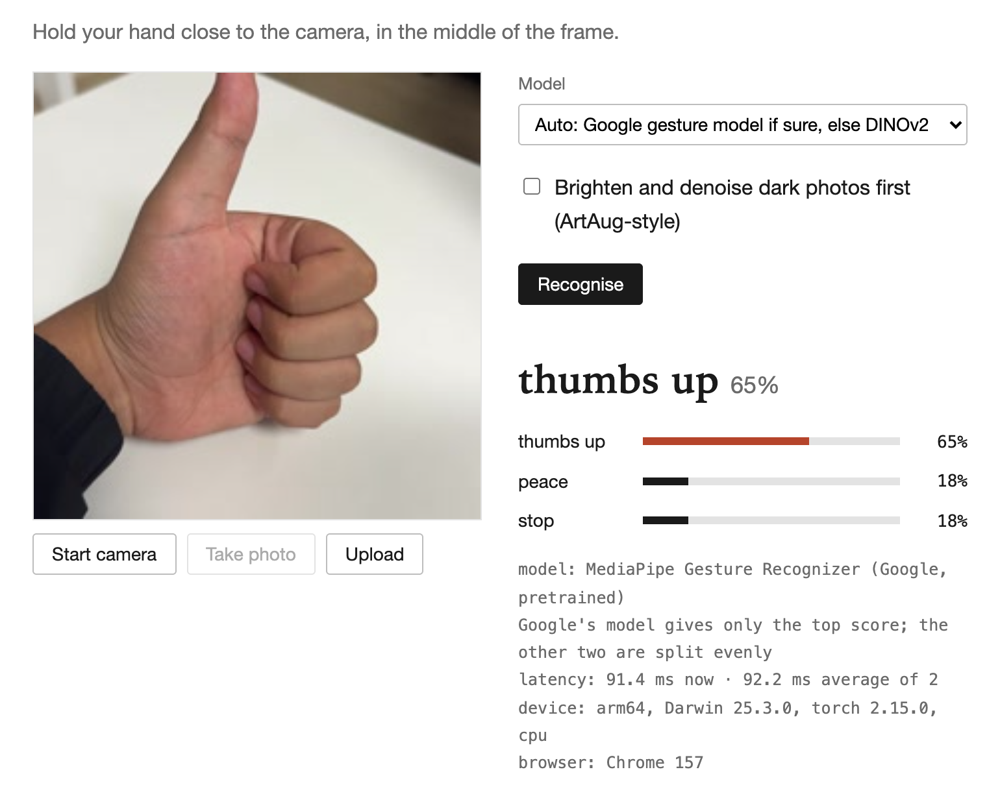
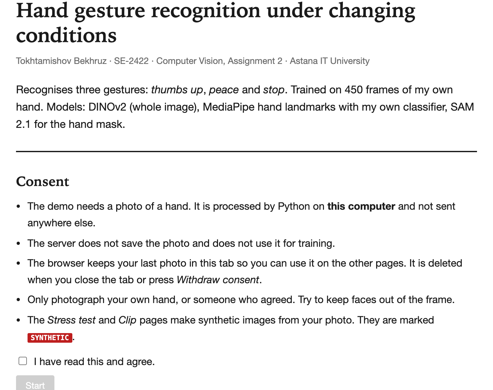
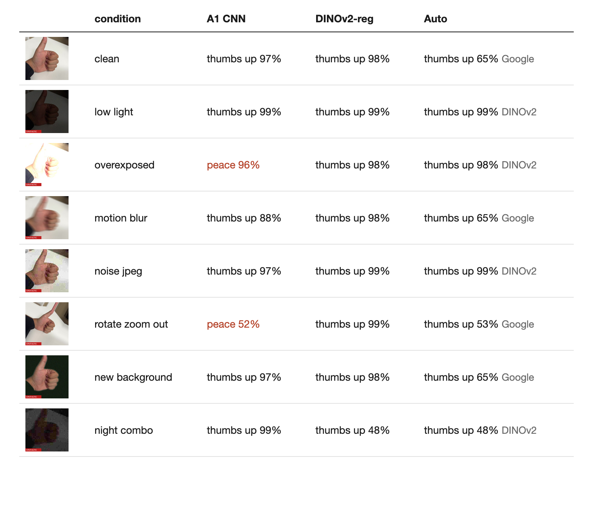

# Hand Gesture Recognition — Assignment 2

Computer Vision · Astana IT University · Tokhtamishov Bekhruz, SE-2422

Recognises three hand gestures — 👍 **thumbs up**, ✌️ **peace**, ✋ **stop** — from a photo or a webcam,
and shows *why* the model gave its answer.

- **Demo video:** https://youtu.be/LHSgJIlm6HE
- **Report (PDF):** [Report_Assignment2_Tokhtamishov.pdf](Report_Assignment2_Tokhtamishov.pdf)



---

## What is inside

| Part | What it does |
|---|---|
| **DINOv2-reg ViT-S/14** (Meta) | Main image classifier, fine-tuned on my 315 training photos |
| **MediaPipe Gesture Recognizer** (Google) | Pretrained gesture model; used first in *Auto* mode, works well with a webcam |
| **SAM 2.1** (Meta) | Cuts the hand out of the photo (mask) for the explanation and the background test |
| **MediaPipe hand landmarks + my MLP** | 21 hand points and a small classifier trained on my data |
| **Stress test** | The test photos under 7 synthetic conditions (dark, blur, noise, new background …) |
| **Synthetic clips** | 2-second clips with a moving camera (idea from Step-Video-T2V) |
| **Refine** | “Diagnose → fix” for dark photos (idea from ArtAug) |
| **Website** | Consent page, live camera, answer, latency, device, browser, explanations |

Main result: the A1 CNN drops from **100% → 62.3%** under the synthetic conditions, the new model keeps **96.9%**.

---

## 1. Requirements

- **macOS or Linux** (on Windows use WSL, or the manual steps in section 6)
- **Python 3.10, 3.11 or 3.12** — MediaPipe does not support newer versions yet.
  Check: `python3.12 --version`. On a Mac you can install it with `brew install python@3.12`.
- **git**, **curl** and **ffmpeg** (ffmpeg is only needed for the *Clip* page): `brew install ffmpeg`
- About **3 GB** of free disk space (Python packages + models)
- A webcam (optional — you can also upload a photo)

No GPU is needed. Everything runs on the CPU.

---

## 2. Quick start (one command)

```bash
git clone https://github.com/bexiiiii/assignmnet2_CV.git
cd assignmnet2_CV
./run.sh
```

Then open **http://127.0.0.1:7860** in Chrome, Safari or Firefox.

What `./run.sh` does:

1. creates a Python environment in `.venv/` and installs `requirements.txt`
2. downloads two small MediaPipe model files into `weights/`
3. checks that the trained weights and results are present (they are in the repository)
4. starts the website

The **first start takes 5–10 minutes** (packages, plus DINOv2, SAM 2.1 and U2-Net download automatically,
about 400 MB). After that it starts in a few seconds.

`run.sh` skips every step that is already done, so you can run it again at any time — nothing is
downloaded or created twice.

| Command | When to use |
|---|---|
| `./run.sh` | normal start |
| `./run.sh --no-app` | only prepare, do not start the website |
| `./run.sh --force` | retrain and re-evaluate everything (needs the A1 dataset, see section 5) |

Stop the website with **Ctrl + C**.

---

## 3. How to use the website

The site has five pages (menu at the top).

### Start — consent
Read the consent text, tick **“I have read this and agree”** and press **Start**.
Without consent the other pages do not work, and the server refuses every request.



### Recognise
1. Press **Start camera** and allow camera access in the browser
   (or press **Upload** and choose a photo).
2. Show a gesture and press **Take photo**.
3. Choose a model (default **Auto**) and press **Recognise**.

You will see:
- the answer and the probability of each class
- which model made the decision
- latency: now and the average of all runs
- device and browser
- **Why this answer:** hand landmarks, attention map, SAM 2.1 hand mask, the most similar training images

| Model | Note |
|---|---|
| **Auto** (default) | Google's gesture model if it is sure, otherwise DINOv2. Best for a live webcam |
| DINOv2-reg | the fine-tuned image model |
| Hand landmarks + MLP | my small classifier on the 21 hand points |
| A1 CNN | the baseline from Assignment 1, for comparison |

**Brighten and denoise dark photos first** turns on the ArtAug-style refine step.

### Stress test
Uses the same photo. Press **Run stress test**: the photo is changed in 7 ways and three models answer
for each version. Red means the answer is different from the clean photo.
All generated images have a red **SYNTHETIC** label.



### Clip
Choose a setting (handheld, new room, low light, night) and press **Make clip**.
A 2-second synthetic video is made from your photo, and the chart shows the answer of each model for
every frame.

### Results
Tables and charts from the report.

### Tips for a good result
- Keep the hand **close to the camera** and in the **middle** of the frame.
- Good light helps. For a dark room tick the *Brighten* option.
- On macOS turn off **Reactions** (Control Centre → Video Effects); otherwise the system draws
  emojis over the camera image.
- **Withdraw consent** (top right) deletes your photo from the browser tab and locks the pages again.

---

## 4. Problems and fixes

| Problem | Fix |
|---|---|
| `Python 3.10-3.12 is needed` | install Python 3.12 (`brew install python@3.12`) and run `./run.sh` again |
| `permission denied: ./run.sh` | `chmod +x run.sh` |
| The camera does not start | allow the camera for the site in the browser settings; open the page at `http://127.0.0.1:7860` |
| Port 7860 is already in use | the site is probably already running — just open the address, or stop the old process |
| The *Clip* page shows an error | install ffmpeg: `brew install ffmpeg` (macOS) or `sudo apt install ffmpeg` (Linux) |
| The first start is slow | normal: models are downloaded once |
| The page looks old after an update | hard refresh: **Cmd + Shift + R** (Mac) or **Ctrl + F5** |
| Apple GPU (MPS) freezes | the scripts use the CPU by default (`GESTURE_DEVICE=cpu`); keep it like this |

---

## 5. Rebuild everything from the data (optional)

The repository already contains the trained weights and all results, so this is **not needed** to
run the demo. To reproduce the experiments you need the A1 dataset:

```
../dataset/
  train/{thumbs_up,peace,stop}/*.jpg   (105 per class)
  val/{thumbs_up,peace,stop}/*.jpg     (22 per class)
  test/{thumbs_up,peace,stop}/*.jpg    (23 per class)
```

```bash
./run.sh --force                                  # dataset in ../dataset
GESTURE_DATA=/path/to/dataset ./run.sh --force    # dataset somewhere else
```

This builds the stress test set, trains all models (about 10 minutes on an Apple M2),
evaluates them, makes the clips and figures, and then starts the website.

---

## 6. Manual steps (without run.sh)

```bash
python3.12 -m venv .venv
.venv/bin/pip install -r requirements.txt
curl -L -o weights/hand_landmarker.task https://storage.googleapis.com/mediapipe-models/hand_landmarker/hand_landmarker/float16/latest/hand_landmarker.task
curl -L -o weights/gesture_recognizer.task https://storage.googleapis.com/mediapipe-models/gesture_recognizer/gesture_recognizer/float16/latest/gesture_recognizer.task
GESTURE_DEVICE=cpu .venv/bin/python app.py        # http://127.0.0.1:7860
```

On Windows (PowerShell) use `.venv\Scripts\python` instead of `.venv/bin/python`,
and set the device with `$env:GESTURE_DEVICE="cpu"`.

Rebuilding step by step (needs the dataset):

```bash
.venv/bin/python src/make_stress_set.py      # synthetic stress test set + hand masks
.venv/bin/python src/train.py                # A1 baselines and DINOv2 variants
.venv/bin/python src/train_landmarks.py      # hand-landmark MLP
GESTURE_DEVICE=cpu .venv/bin/python src/evaluate.py
GESTURE_DEVICE=cpu .venv/bin/python src/extras_light.py
.venv/bin/python src/eval_cascade.py
GESTURE_DEVICE=cpu .venv/bin/python src/figures_extra.py
GESTURE_DEVICE=cpu .venv/bin/python src/clips.py
```

---

## 7. Results

Accuracy (%) on the 69 test photos:

| Model | clean | dark | blur | new background | night | average of 7 conditions |
|---|---|---|---|---|---|---|
| LogReg (A1) | 100 | 100 | 100 | 26.1 | 100 | 83.2 |
| CNN (A1) | 100 | 33.3 | 98.6 | 49.3 | 33.3 | 62.3 |
| **DINOv2-reg + env-aug** | **100** | **100** | **97.1** | **100** | **82.6** | **96.9** |
| Auto (Google → DINOv2) | 100 | 100 | 97.1 | 98.6 | 82.6 | 95.9 |

All numbers are in `results/*.json`, all charts in `results/*.png`. Details are in the report.

---

## 8. Project structure

```
run.sh                 one command: setup + start
app.py                 web server (FastAPI) and API; checks consent on every request
web/                   website: index (consent), recognise, stress, clip, results
src/common.py          paths, classes, dataset loader
src/models.py          A1 CNN and DINOv2-reg classifier
src/train.py           training of the image models
src/landmarks.py       MediaPipe hand landmarks + Google Gesture Recognizer
src/train_landmarks.py hand-landmark MLP
src/stress.py          synthetic conditions, augmentation, SAM 2.1 hand masks
src/make_stress_set.py builds the stress test set
src/clips.py           synthetic clips + per-frame evaluation
src/enhance.py         ArtAug-style refine
src/explain.py         Grad-CAM, attention rollout, nearest neighbours
src/evaluate.py        accuracy / F1 per condition
src/extras_light.py    latency, explanation focus, retrieval
src/eval_cascade.py    Auto mode evaluation
src/figures_extra.py   figures for the report
results/               metrics (json), charts, screenshots, example clips
weights/               trained weights
```

---

## 9. Privacy and synthetic media

- The website works only after the user agrees. The server keeps photos in memory and does not save them.
- The browser keeps the last photo only in the open tab; *Withdraw consent* deletes it.
- Every generated image and clip has a red **SYNTHETIC** label (files start with `SYN_`).
- The training data contains only my own hand.
